<!-- START_SECTION:wyvern -->
<div align="center">

### 🔴 Active Companion: **Drogon** — *The Black Dread Reborn*

<a href="https://github.com/topics/game-of-thrones">
  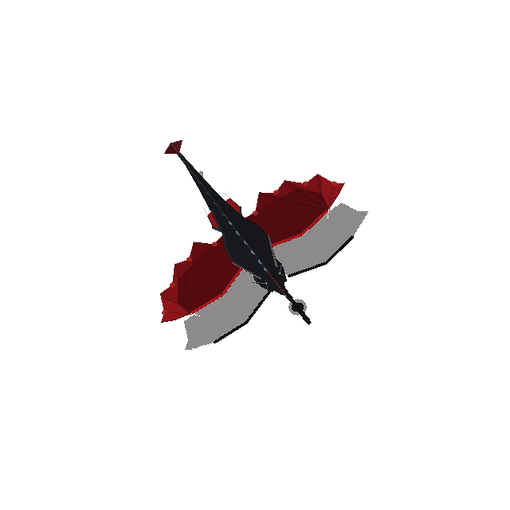
</a>

```text
┌────────────────────────────────────────────────────────────────────────┐
│  🐲 Companion   : Drogon         Series  : Game of Thrones           │
│  👑 Bonded Rider: Daenerys Targaryen Faction : House Targaryen           │
│  🔥 Breath Type : Blood-Red Dragonfire                            │
│  ✨ Growth Stage: Stage 1: Dragon Egg                             │
│  ⚡ Power Level : 385   XP        Commits : 11    ( 36% to Next Level) │
│  📈 Growth Bar  : [██████░░░░░░░░░░] (36% to Stage 2)           │
└────────────────────────────────────────────────────────────────────────┘
```
> *"The largest and most ferocious of Daenerys's brood. Pitch-black hide with blood-red wing ribbing."*

</div>
<!-- END_SECTION:wyvern -->

---

<div align="center">

# 🐉 Git-Wyvern
### Autonomous 16-Bit Dragon Evolution & Aerial Hunt Engine for GitHub Profiles
#### *Game of Thrones* &bull; *House of the Dragon* &bull; Pure Safe Rust

[](https://www.rust-lang.org/)
[](#-pure-rust-engine--architecture)
[](#-vertebrate-aeronautics--predatory-physics-dorsal-hunt-engine)
[](#-the-grand-wyvern-exhibition-all-16-canon-dragons)
[](#-how-to-deploy-in-your-github-profile)
[](LICENSE)

<br/>

> *"A dragon is not a slave."* &mdash; **Daenerys Targaryen**  
> *"Dreams didn't make us kings. Dragons did."* &mdash; **Daemon Targaryen**

<br/>

**Git-Wyvern** is a dynamic, master 16-bit pixel-art dragon evolution engine for your GitHub Profile README (inspired by `git-koi`). As you commit code and push repositories, your bonded dragon companion incubates inside a petrified archosaurian egg, hatches, perches as a fledgling, banks in agile flight, and evolves into a titanic ancient apex wyvern soaring across an expansive **640 &times; 640 sky arena** with live predatory hunting and roaring dragonfire!

</div>

---

## 📑 Table of Contents
1. [🌌 Vertebrate Aeronautics & Predatory Physics (Dorsal Hunt Engine)](#-vertebrate-aeronautics--predatory-physics-dorsal-hunt-engine)
2. [🥚 Master 3-Stage Evolution Lifecycle](#-master-3-stage-evolution-lifecycle)
3. [⚔️ The Grand Wyvern Exhibition (All 16 Canon Dragons)](#-the-grand-wyvern-exhibition-all-16-canon-dragons)
   - [I. The Game of Thrones Brood](#i-the-game-of-thrones-brood)
   - [II. House of the Dragon: The Blacks (Team Rhaenyra)](#ii-house-of-the-dragon-the-blacks-team-rhaenyra)
   - [III. House of the Dragon: The Greens (Team Aegon)](#iii-house-of-the-dragon-the-greens-team-aegon)
   - [IV. Ancient Legends, Wild & Solitary Wyverns](#iv-ancient-legends-wild--solitary-wyverns)
4. [🦀 Pure Rust Engine & Architecture](#-pure-rust-engine--architecture)
5. [🚀 Quickstart & Local Execution](#-quickstart--local-execution)
6. [🌐 How to Deploy in Your GitHub Profile](#-how-to-deploy-in-your-github-profile)
7. [⚙️ Complete CLI & Environment Configuration](#️-complete-cli--environment-configuration)
8. [📜 Lore & Canon Verification](#-lore--canon-verification)

---

## 🌌 Vertebrate Aeronautics & Predatory Physics (Dorsal Hunt Engine)

Inspired by the dorsal top-down view and 1:1 pixel aesthetic of `git-koi`, **Git-Wyvern** replaces simplified fish undulations with authentic **vertebrate flight biomechanics** and an interactive predatory ecosystem rendered in pure Rust:

<div align="center">

| Drogon: Lemniscate of Gerono & Flame-Roast | Caraxes: Sinuous Ribbon Wave & Viper Strike |
|:---:|:---:|
| <br/>*Bilateral delta wings &bull; Figure-8 power dive &bull; Aerial sheep flame-roast* | 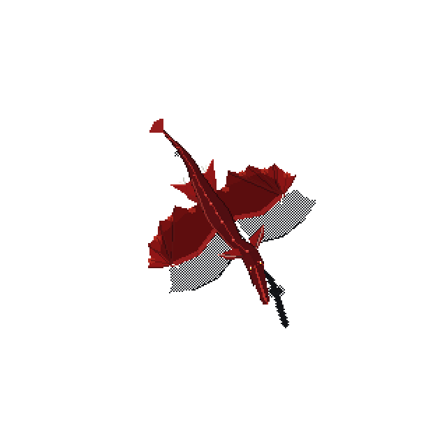<br/>*Mutated serpentine S-neck &bull; Webbed ankle rudders &bull; Running boar strike* |

</div>

### 1. True Wyvern Morphology (4 Limbs vs 6 Limbs)
Grounded in George R.R. Martin's strict biological mandate for *A Song of Ice and Fire*: **no real vertebrate on Earth possesses six limbs**. Dragons in Westeros are biologically **wyverns** &mdash; two clawed bat-wing forelimbs and two powerful hind limbs. In aerial flight, the hind legs tuck aerodynamically beneath the pelvic girdle with the talons clenched.

### 2. Rigid Thoracic Keel Biomechanics
Unlike aquatic fish that undulate laterally across their spine, flying vertebrates (*Chiroptera*, *Pterosauria*, *Aves*) feature an immovable, fused thoracic ribcage and massive sternal keel anchoring the powerful pectoralis downstroke muscles. Lateral body flexion is strictly confined to the pre-thoracic cervical neck and the post-pelvic caudal tail rudder.

### 3. 3D Wing Folding & Camber Kinematics
- **Downstroke (Power Phase)**: The humerus protracts downward and forward, the carpal wrist extends outward, and elongated finger spars (digits II&ndash;V) fan to maximum surface area and camber (+20% wingspan).
- **Upstroke (Recovery Phase)**: The humerus elevates and retracts backward, the elbow flexes, and the wrist **folds tightly inward toward the flank** (-25% span) with digits collapsing to minimize parasitic drag.

### 4. 16 Unique Mathematical Flight Trajectories $(x(t), y(t))$
Every single dragon patrols an idiosyncratic, closed parametric flight trajectory across the transparent 640 &times; 640 sky arena:
- **Drogon**: Lemniscate of Gerono (Power Figure-8) with steep high-speed dive stoop through the center.
- **Rhaegal**: 3:2 Lissajous serpentine canyon weave with sharp 60&deg; banking turns.
- **Viserion**: Concentric Archimedean thermal spiral with alternating expansion and contraction radii.
- **Wight Viserion**: Fractured erratic stutter-loop with unnatural angular undead pivots.
- **Caraxes**: Ultra-elongated undulating ribbon wave with trailing secondary ripple harmonics.
- **Vhagar**: Colossal wide perimeter sweep with thunderous mass and a ground-skimming stoop.
- **Syrax**: Aristocratic golden teardrop loop with royal soaring flares.
- **Meleys**: Supersonic ultra-flat oval interceptor path (the fastest dragon in Westeros).
- **Sunfyre**: Trifolium 3-petal butterfly aerobatic loop with gleaming golden rolls.
- **Vermithor**: Heavy horseshoe brute patrol with deep predatory stoop and bone-crushing mass.
- **Silverwing**: Regal horizontal Lemniscate of Bernoulli (smooth infinity loop $\infty$).
- **Seasmoke**: Coastal surf-skimming oval with low wave-hugging drift and upward thermal hook.
- **Sheepstealer**: Erratic moorland zigzag scavenger loop scouring the crags.
- **Balerion**: Apocalyptic celestial eclipse sweep spanning the outer limits of the sky.
- **Moondancer**: Falcon-like 4-cusp astroid canyon darting with rapid snap accelerations.
- **Tessarion**: Swift acrobatic 4-leaf cloverleaf bank patrol with high-G rolls.

### 5. Combustion Physics & Emissive Radiance
- **Forward Radiance Emissive Bloom**: Active dragonfire columns project dynamic inverse-distance radial illumination forward across the snout, maxilla, orbital brow arches, rostral horns, cervical scutes, and leading wing propatagium.
- **Multi-Tiered Esophageal Transillumination**: Pre-ignition throat glow is split into 3 distinct tiers: lateral soft-tissue subcutaneous diffusion + main combustion mantle + white-hot core filament.
- **Ground Fire Light Pool**: Active firecolumns project an expanding elliptical illumination pool onto the terrain below, modulated dynamically by flight altitude ($d_{\text{alt}}$).
- **Secondary Radial Prey Shadow**: During active combustion, ground prey casts dual shadows: the primary celestial sun shadow plus an elongated secondary cast shadow stretching radially outward away from the intense flame source.

### 6. Dynamic Volumetric Shadow & Atmospheric Rayleigh Tint
- **Sun Azimuth Vector**: The ground drop shadow tracks celestial sun positioning:
  $$S = [0.55,\, 0.65] \times d_{\text{alt}}$$
- **Dual-Density Shadow**: High-density opaque umbra beneath solid skeletal structures (cranium, vertebral column, humerus) vs semi-translucent penumbra beneath thin wing membranes.
- **Altitude Diffusion & Rayleigh Tint**: High cruising altitudes expand and soften shadow boundaries via penumbral diffusion; shadow hues are tinted by the dragon's elemental aura (volcanic cinder for Drogon, glacial slate-blue for Wight Viserion, warm amber for Sunfyre).

### 7. Procedural Prey Ecosystem & 6 Canon Feeding Styles
Live prey spawns procedurally across the terrain (sheep, wild boars, primeval aurochs, stags, and mountain goats). When the wyvern's shadow sweeps overhead, prey panics (`!`, sweat motes) and flees. Feeding styles follow canon lore:
1. **Aerial Flame-Roast & Toss** (*Drogon, Tessarion, Sunfyre*): Searing dragonfire strafes the prey, talons snatch the roasted morsel aloft, toss it mid-air, and gaping jaws snap it whole!
2. **Cavernous Ground Gulp** (*Vhagar, Balerion, Vermithor*): Jaws unhinge wide to skim the earth, scooping entire cattle/bulls whole with visible throat peristalsis down the neck!
3. **Serpentine Viper Neck Strike** (*Caraxes, Rhaegal*): Long neck coils into an S-curve and strikes like a viper, snapping jaws around the running boar!
4. **Raptor Talon Pin & Aerial Feast** (*Moondancer, Meleys, Sheepstealer*): High-speed talon strike spears running prey, lifting it aloft to tear with razor fangs!
5. **Cryogenic Frost Shatter** (*Wight Viserion*): Freezes prey in pale cobalt plasma, then shatters it into a burst of glittering ice crystal shards!
6. **Royal Aristocratic Scoop** (*Syrax, Silverwing, Viserion, Seasmoke*): Elegant glide-by scoop and graceful mid-flight swallow!

---

## 🥚 Master 3-Stage Evolution Lifecycle

As your GitHub contributions accumulate, your companion grows through **3 distinct, high-impact developmental stages**:

<div align="center">

| Stage 1: Dragon Egg | Stage 2: Hatchling Wyvern | Stage 3: Apex Soaring Dread |
|:---:|:---:|:---:|
| 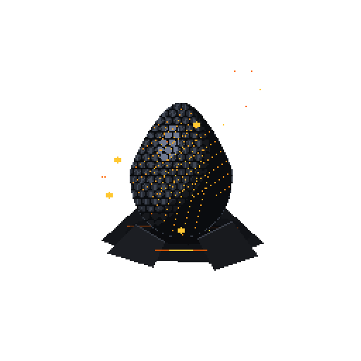<br/>*Petrified egg &bull; Magma fissures &bull; Floating embers* | 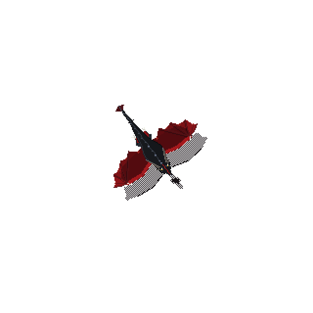<br/>*Juvenile aerial patrol &bull; 144 frames &bull; Fledgling hunt* | <br/>*Apex aerial hunt &bull; 144 frames &bull; Roaring dragonfire* |

</div>

<br/>

| Stage | Name | Commits | Visual Progression & Biological Lore | Aerial Flight Mode |
|:---:|:---|:---:|:---|:---:|
| **1** | **Dragon Egg** | `0 – 29` | Petrified ovoid resting upright on its broad rounded base with conical apex pointing UP. Interlocking diamond or pinecone scale tessellations, living embryonic heartbeat, bespoke fluid non-horizontal veins, species elemental cradle, and floating motes. | Nestled in Elemental Cradle |
| **2** | **Hatchling Wyvern** | `30 – 99` | Freshly hatched young wyvern taking flight across the aerial sky arena ($0.85\times$ scale). Articulated wing beats, high-agility banking turns, and fledgling dragonfire tests. | **Aerial Patrol & Hunt (0.85&times;)** |
| **3** | **Apex Soaring Dread** | `100+` | Full colossal apex predator ($1.15\times$ scale) with unclipped wingspan, predatory fangs, quadrate rotational jaw hinge, procedural prey ecosystem, and soaring 144-frame aerial hunt with roaring dragonfire. | **Apex Aerial Hunt & Patrol (1.15&times;)** |

---

## ⚔️ The Grand Wyvern Exhibition (All 16 Canon Dragons)

Every single canon dragon from *Game of Thrones* and *House of the Dragon* has been individually sculpted with authentic show-accurate morphology, scale palettes, eye colors, horn architectures, and elemental cradles.

---

### I. The Game of Thrones Brood

#### 1. Drogon &mdash; *The Black Dread Reborn*
*Bonded Rider*: **Daenerys Targaryen** &bull; *Faction*: House Targaryen  
*Lore*: The largest and most ferocious of Daenerys's brood. Pitch-black hide with blood-red wing ribbing, straight-back horns, and crimson firestorm that melted the Iron Throne.

<div align="center">

| Stage 1: Basalt Hearth Egg | Stage 3: Apex Aerial Hunt & Sheep Roast |
|:---:|:---:|
| <br/>*Pinecone scale shingles &bull; Magma chasm rifts &bull; Volcanic embers* | <br/>*Lemniscate of Gerono &bull; Blood-red dragonfire &bull; Sheep toss & catch* |

</div>

#### 2. Rhaegal &mdash; *The Jade Serpent*
*Bonded Rider*: **Jon Snow (Aegon Targaryen)** &bull; *Faction*: House Targaryen  
*Lore*: Deep emerald and dark jade-green scales with burnished bronze-gold wing membranes. Named in honor of Prince Rhaegar Targaryen.

<div align="center">

| Stage 1: Mossy Ruins Egg | Stage 3: Apex Aerial Hunt & Boar Strike |
|:---:|:---:|
| 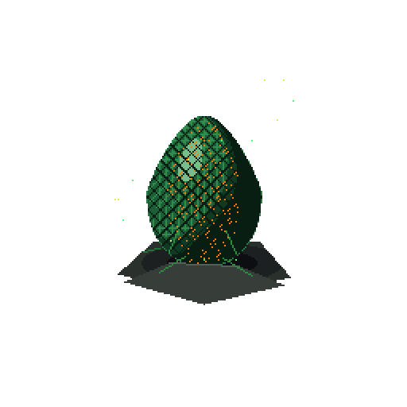<br/>*Diamond scales &bull; Emerald moss tendrils &bull; Bio-capillary pulse* | 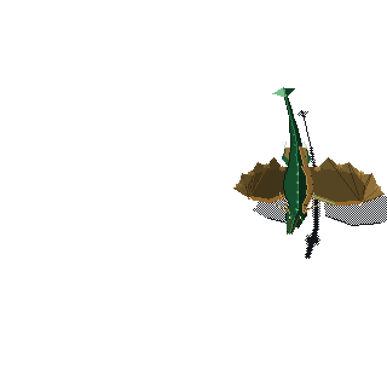<br/>*3:2 Lissajous weave &bull; Emerald-gold flame &bull; Serpentine viper strike* |

</div>

#### 3. Viserion &mdash; *The Golden Frost*
*Bonded Rider*: **Daenerys Targaryen** &bull; *Faction*: House Targaryen  
*Lore*: Splendid cream-white hide with burnished golden-yellow wing membranes and golden horns. Named in memory of Viserys Targaryen.

<div align="center">

| Stage 1: Ivory Brazier Egg | Stage 3: Apex Aerial Hunt |
|:---:|:---:|
| <br/>*Diamond scales &bull; Targaryen ivory-gold brazier &bull; Gold filigree veins* | 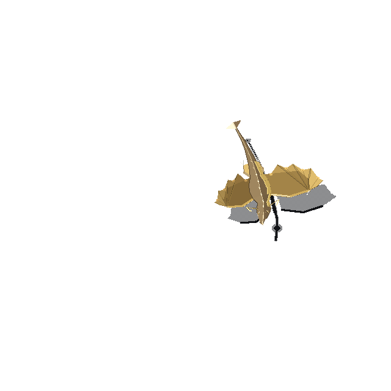<br/>*Archimedean spiral glide &bull; Golden-white dragonfire &bull; Aristocratic scoop* |

</div>

#### 4. Wight Viserion &mdash; *The Undead Ice Wyvern*
*Bonded Rider*: **The Night King** &bull; *Faction*: The White Walkers / Army of the Dead  
*Lore*: Slain at the frozen lake beyond the Wall and resurrected by the Night King. Piercing cyan eye, tattered wing membranes, and supersonic cobalt plasma beam that brought down the Wall.

<div align="center">

| Stage 1: Glacial Shelf Egg | Stage 3: Apex Undead Patrol & Ice Shatter |
|:---:|:---:|
| 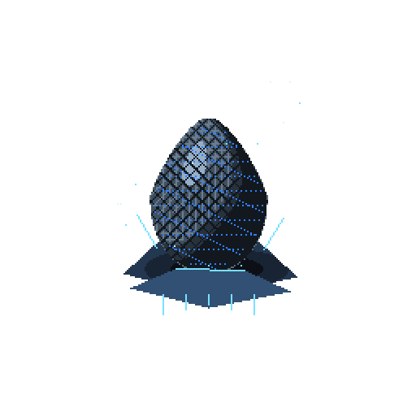<br/>*Diamond scales &bull; Frozen permafrost shelf &bull; Frost fracture rifts* | 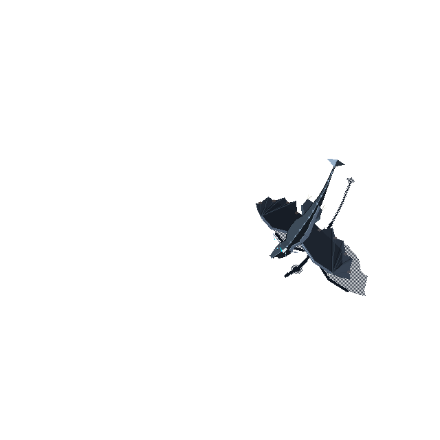<br/>*Erratic angular pivots &bull; Cobalt plasma beam &bull; Cryogenic freeze shatter* |

</div>

---

### II. House of the Dragon: The Blacks (Team Rhaenyra)

#### 5. Caraxes &mdash; *The Blood Wyrm*
*Bonded Rider*: **Prince Daemon Targaryen** &bull; *Faction*: The Blacks  
*Lore*: Mutated, fearsome serpentine red beast with an elongated neck, forward ear-frills, webbed rear-ankle rudder wings, and a shrill piercing scream.

<div align="center">

| Stage 1: Sulfur Fumarole Egg | Stage 3: Apex Aerial Hunt & Viper Strike |
|:---:|:---:|
| 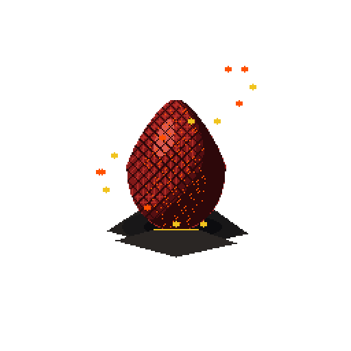<br/>*Reference diamond scales &bull; Sulfur fumarole vent &bull; Carmic bio-capillaries* | <br/>*Undulating ribbon wave &bull; Sinuous viper strike &bull; Deep crimson fire* |

</div>

#### 6. Meleys &mdash; *The Red Queen*
*Bonded Rider*: **Princess Rhaenys Targaryen** &bull; *Faction*: The Blacks  
*Lore*: Magnificent scarlet scales with soft pink wing membranes and a crown of copper horn frills. Renowned as the fastest, swiftest dragon in all of Westeros.

<div align="center">

| Stage 1: Smelting Slag Egg | Stage 3: Apex Supersonic Interceptor Hunt |
|:---:|:---:|
| 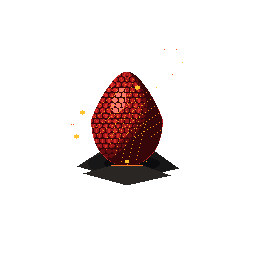<br/>*Pinecone scale shingles &bull; Smelting slag hearth &bull; Magma chasm rifts* | 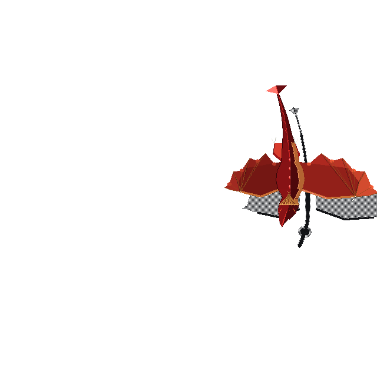<br/>*Ultra-flat oval interceptor &bull; Scarlet dragonfire &bull; Raptor talon strike* |

</div>

#### 7. Syrax &mdash; *The Golden Queen*
*Bonded Rider*: **Queen Rhaenyra Targaryen** &bull; *Faction*: The Blacks  
*Lore*: Sleek, elegant sulfur-yellow scales with pale cream wings and noble backward cranial horns. Well-fed, dignified, and regal companion of the Queen.

<div align="center">

| Stage 1: Gilded Pedestal Egg | Stage 3: Apex Royal Aerial Soar |
|:---:|:---:|
| 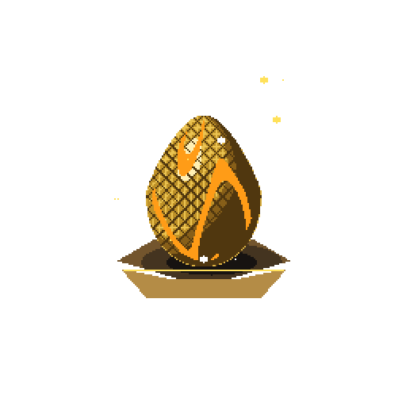<br/>*Diamond scales &bull; Gilded sandstone pedestal &bull; Gold filigree veins* | 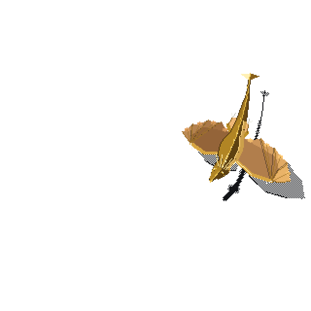<br/>*Royal teardrop loop &bull; Radiant golden fire &bull; Aristocratic swoop* |

</div>

#### 8. Vermithor &mdash; *The Bronze Fury*
*Bonded Rider*: **King Jaehaerys I &bull; Hugh Hammer** &bull; *Faction*: The Blacks  
*Lore*: Colossal bronze-tan beast of immense girth, heavy boxy jaw with chin beard spikes. The second largest living dragon after Vhagar.

<div align="center">

| Stage 1: Smelting Slag Egg | Stage 3: Apex Brute Ground Skim |
|:---:|:---:|
| 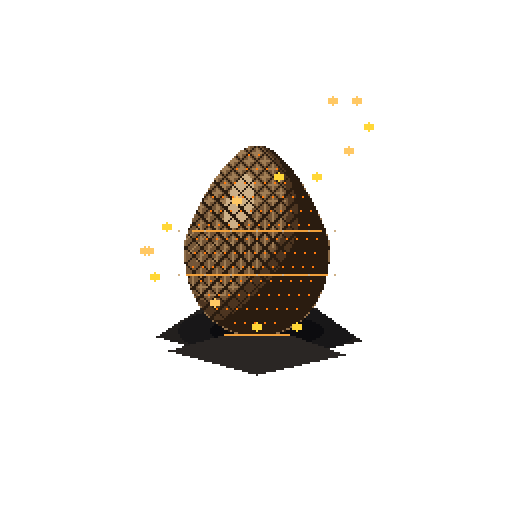<br/>*Diamond scales &bull; Bronze reinforcing hoops &bull; Molten bronze veins* | 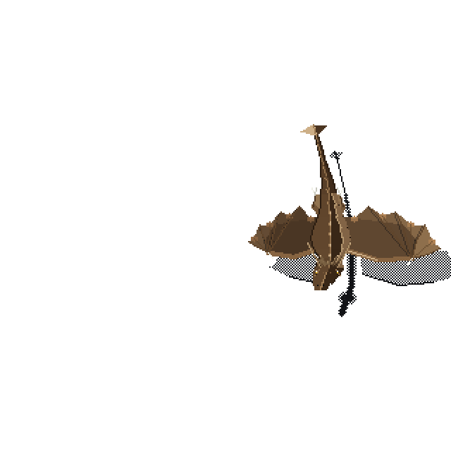<br/>*Horseshoe brute patrol &bull; Molten forge breath &bull; Cavernous ground gulp* |

</div>

#### 9. Seasmoke &mdash; *The Pale Ghost of Driftmark*
*Bonded Rider*: **Ser Laenor Velaryon &bull; Addam of Hull** &bull; *Faction*: The Blacks  
*Lore*: Pale smoky silver-grey dragon with translucent wing membranes, thriving over the rolling sea brine and coral reefs of Driftmark.

<div align="center">

| Stage 1: Reef Driftwood Egg | Stage 3: Apex Coastal Surf-Skim |
|:---:|:---:|
| 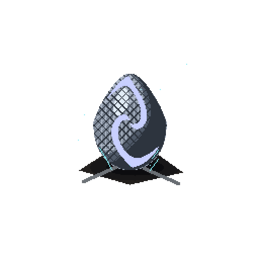<br/>*Diamond scales &bull; Tidal vortex spiral &bull; Coral spurs on driftwood* | 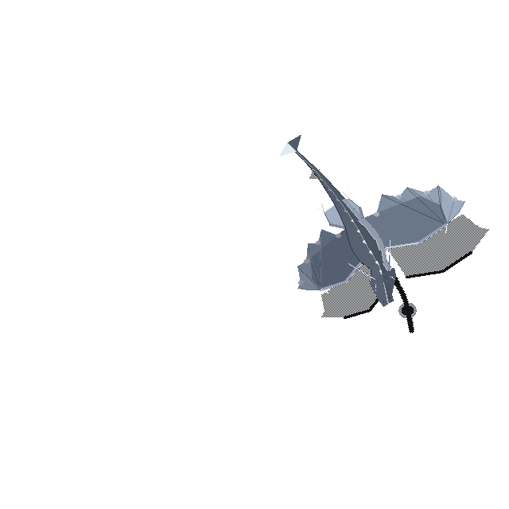<br/>*Coastal surf oval &bull; Pale yellow-orange fire &bull; Sea-spray mist motes* |

</div>

#### 10. Moondancer &mdash; *The Pale Green Quick-wing*
*Bonded Rider*: **Lady Baela Targaryen** &bull; *Faction*: The Blacks  
*Lore*: Slender, lightning-fast pale green dragon with mint-tinted wing membranes, delicate bones, and an upright cranial crest.

<div align="center">

| Stage 1: Amethyst Geode Egg | Stage 3: Apex Astroid Canyon Dart |
|:---:|:---:|
| 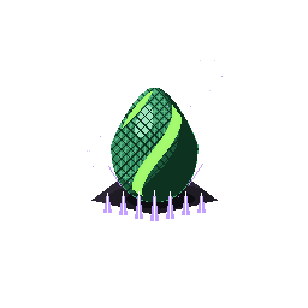<br/>*Diamond scales &bull; Helical astral ribbon &bull; Lilac quartz needles* | 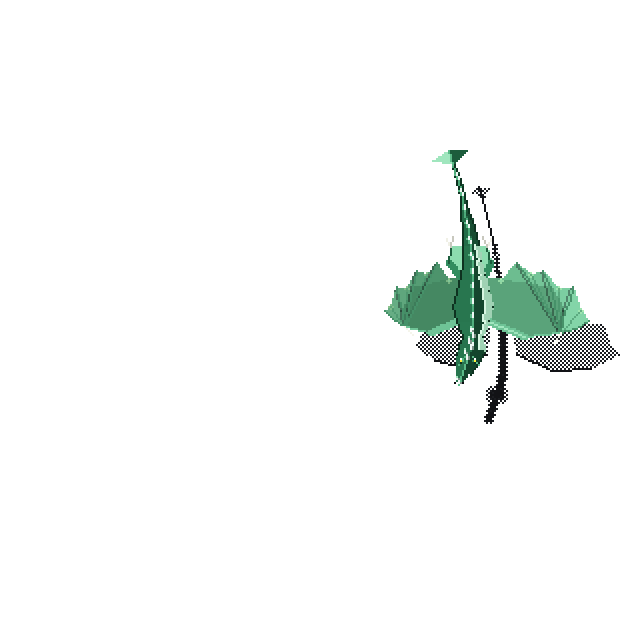<br/>*4-cusp astroid canyon dart &bull; Lime-gold flame &bull; Raptor talon pin* |

</div>

---

### III. House of the Dragon: The Greens (Team Aegon)

#### 11. Vhagar &mdash; *The Queen of All Dragons*
*Bonded Rider*: **Prince Aemond Targaryen** (formerly Visenya, Baelon, Laena) &bull; *Faction*: The Greens  
*Lore*: The oldest, largest, and most devastating dragon in Westeros (180+ years old). Mottled bronze-green scales, sagging throat dewlap, and colossal jaw that swallows dragons whole.

<div align="center">

| Stage 1: Ancient Ruins Egg | Stage 3: Apex Apocalyptic Behemoth Patrol |
|:---:|:---:|
| 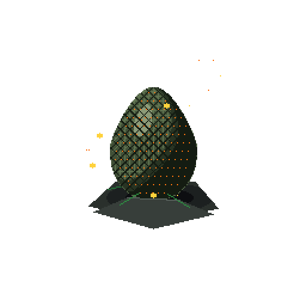<br/>*Diamond scales &bull; Overgrown Valyrian ruins &bull; Bronze stone fissures* | 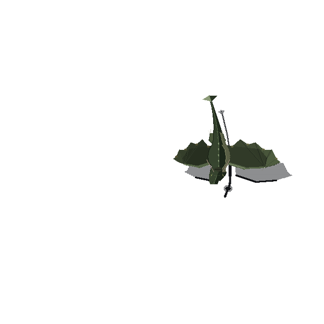<br/>*Perimeter sky sweep &bull; Roaring volcanic firestorm &bull; Cavernous cattle gulp* |

</div>

#### 12. Sunfyre &mdash; *Sunfyre the Golden*
*Bonded Rider*: **King Aegon II Targaryen** &bull; *Faction*: The Greens  
*Lore*: Acclaimed as the most gorgeous dragon ever seen in the known world. Gleaming burnished gold scales that shine in sunlight, pale rose-pink wing membranes, and golden flame.

<div align="center">

| Stage 1: Gilded Dais Egg | Stage 3: Apex Trifolium Aerobatic Roll |
|:---:|:---:|
| 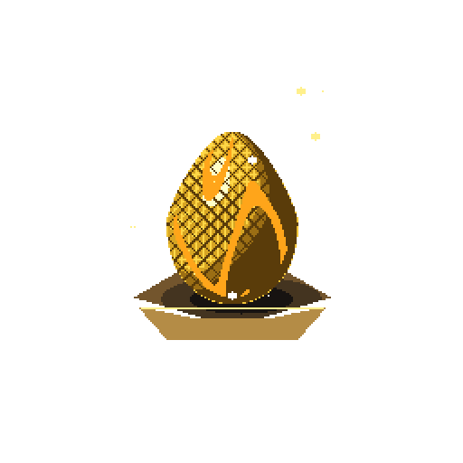<br/>*Diamond scales &bull; Sunburst gilded dais &bull; Golden filigree veins* | 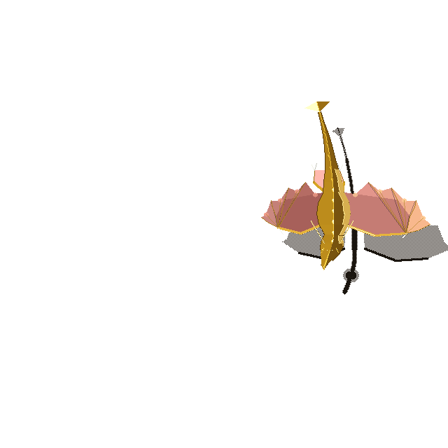<br/>*Trifolium 3-petal loop &bull; Incandescent golden flame &bull; Aerial roast & catch* |

</div>

#### 13. Tessarion &mdash; *The Blue Queen*
*Bonded Rider*: **Prince Daeron Targaryen** &bull; *Faction*: The Greens  
*Lore*: The youngest dragon of the Greens. Magnificent dark cobalt-blue scales with beaten copper wings, copper claws and belly scutes, and roaring cobalt dragonfire.

<div align="center">

| Stage 1: Amethyst Geode Egg | Stage 3: Apex Cloverleaf Acrobatic Bank |
|:---:|:---:|
| 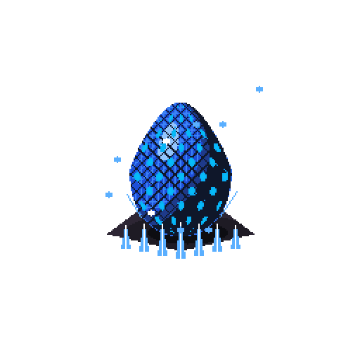<br/>*Diamond scales &bull; Electric diamond arc discharge &bull; Electric blue motes* | 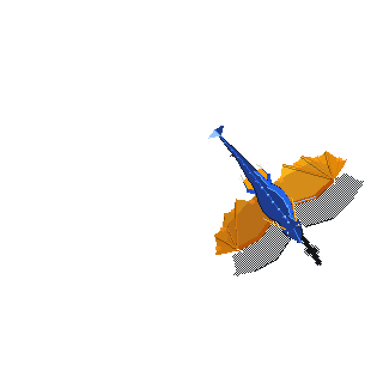<br/>*4-leaf cloverleaf bank &bull; Cobalt-copper dragonfire &bull; Aerial roast & toss* |

</div>

---

### IV. Ancient Legends, Wild & Solitary Wyverns

#### 14. Balerion &mdash; *The Black Dread*
*Bonded Rider*: **Aegon the Conqueror &bull; King Viserys I** &bull; *Faction*: Ancient Valyrian Legend  
*Lore*: The apocalyptic titan of the Conquest whose wingspan darkened entire cities in an eclipse of terror. Jaws wide enough to swallow an aurochs whole; black fire shot with crimson.

<div align="center">

| Stage 1: Volcanic Hearth Egg | Stage 3: Apex Eclipse Soar |
|:---:|:---:|
| 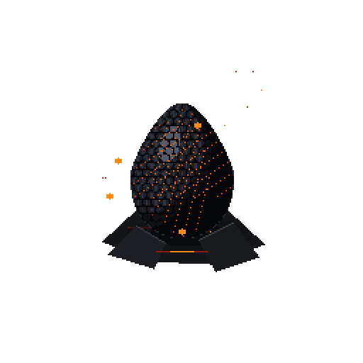<br/>*Pinecone scale shingles &bull; Basalt hearth &bull; Black ash & volcanic embers* | 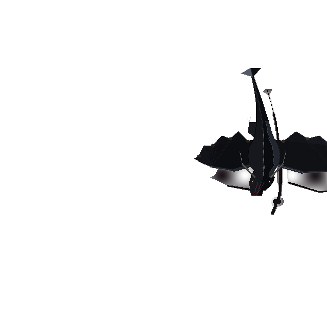<br/>*Apocalyptic celestial sweep &bull; Black-crimson flame &bull; Mammoth aurochs gulp* |

</div>

#### 15. Silverwing &mdash; *The Pale Lady*
*Bonded Rider*: **Good Queen Alysanne Targaryen &bull; Ulf White** &bull; *Faction*: The Dragonmount  
*Lore*: A docile, shimmering silvery-grey she-dragon. Flew with Queen Alysanne to the Wall, refusing to fly beyond it into the cold unknown.

<div align="center">

| Stage 1: Ivory Brazier Egg | Stage 3: Apex Bernoulli Infinity Soar |
|:---:|:---:|
| 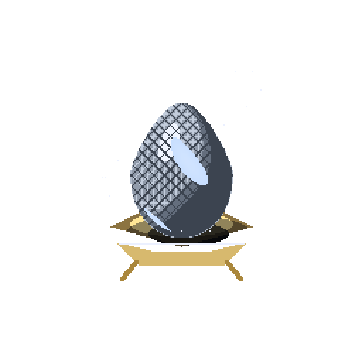<br/>*Diamond scales &bull; Sweeping diagonal lunar aurora veil &bull; Silver sparks* | 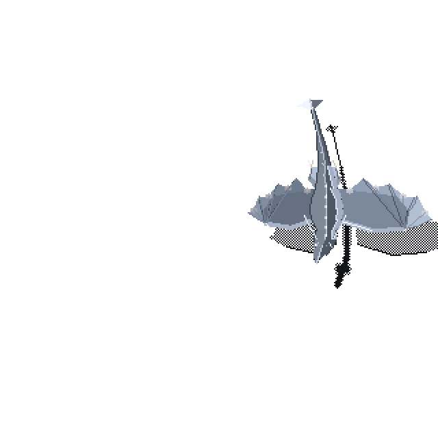<br/>*Bernoulli infinity loop $\infty$ &bull; Pearlescent silver-white flame* |

</div>

#### 16. Sheepstealer &mdash; *The Wild Brown Scavenger*
*Bonded Rider*: **Nettles** &bull; *Faction*: Wild Dragons of the Dragonmount  
*Lore*: An untamed, mud-brown wild dragon who nested in the craggy volcanic vents of the Dragonmount, tamed by Nettles through daily sheep offerings.

<div align="center">

| Stage 1: Mountain Scree Egg | Stage 3: Apex Moorland Scavenger Loop |
|:---:|:---:|
| 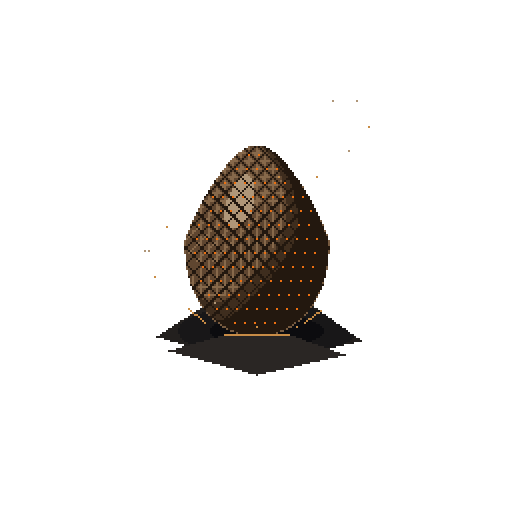<br/>*Diamond scales &bull; Mountain scree boulders &bull; Mountain heather twigs* | 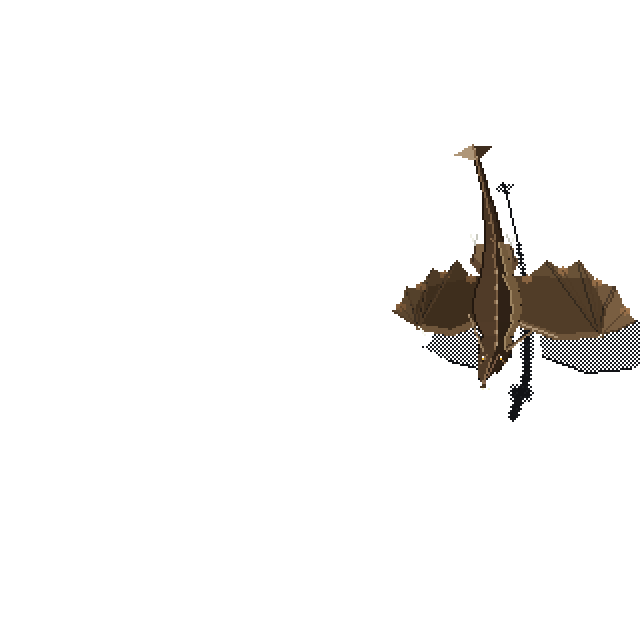<br/>*Erratic zigzag terrain hug &bull; Smoky orange fire &bull; Mountain mutton strike* |

</div>

---

## 🦀 Pure Rust Engine & Architecture

Git-Wyvern was engineered from first principles in **100% pure Safe Rust** with **zero runtime C or Python dependencies**:

```text
git-wyvern/
├── Cargo.toml                  # Minimal fast release profile (LTO = true, codegen-units = 1)
├── src/
│   ├── canvas.rs               # Pixel rasterizer, alpha blending, 2x nearest-neighbor integer clustering
│   ├── egg.rs                  # 3D normal curvature egg model, 4 fluid transitions, elemental cradles
│   ├── encoder.rs              # Zero-dependency streaming animated GIF encoder
│   ├── main.rs                 # CLI entry point, git commit counter, markdown sync engine
│   ├── palette.rs              # 16 canon 5-tier dragon palettes (scales, ventral, wings, eyes, flames)
│   ├── patrol.rs               # 144-frame 640x640 aerial hunt, vertebrate biomechanics, combustion physics
│   ├── prey.rs                 # Procedural prey ecosystem (sheep, boars, aurochs, stags) & panic AI
│   ├── stages.rs               # 3-stage developmental thresholds and power levels
│   ├── topdown.rs              # Mathematical closed parametric trajectories and flight dynamics
│   └── wyvern.rs               # Wyvern anatomy, unhinged jaw rotation, and wing folding
```

### ⚡ Performance Benchmarks
- **Compilation**: Fast dev compilation in under 4 seconds; release build in ~18s.
- **Render Speed**: Generates a complete 144-frame, 640 &times; 640 animated GIF with live prey AI, combustion bloom, and volumetric shadows in **~1.2 seconds**.
- **Batch Mode**: Compiles all 16 canon dragons (48 animated GIFs totaling ~30 MB) in under 1 minute!

---

## 🚀 Quickstart & Local Execution

### Prerequisites
- [Rust toolchain](https://www.rust-lang.org/tools/install) (`cargo` and `rustc` version 1.70+).
- Git.

### 1. Clone the Repository
```bash
git clone https://github.com/<your-username>/git-wyvern.git
cd git-wyvern
```

### 2. Evolve a Wyvern Companion Locally
```bash
# Render Drogon with 150 commits (Stage 3 Apex Soaring Dread with Sheep Roast):
cargo run --release --manifest-path git-wyvern/Cargo.toml -- drogon 150 patrol

# Render Tessarion with 1 commit (Stage 1 Dragon Egg with Electric Arcs):
cargo run --release --manifest-path git-wyvern/Cargo.toml -- tessarion 1 patrol
```

### 3. Batch Compile All 16 Dragons
```bash
cargo run --release --manifest-path git-wyvern/Cargo.toml -- --batch-all
```

---

## 🌐 How to Deploy in Your GitHub Profile

You can embed Git-Wyvern into your GitHub profile so your dragon companion evolves automatically as you push code!

### Step 1: Add the Workflow File
In your repository, save the following as `.github/workflows/wyvern.yml`:

```yaml
name: Git-Wyvern Evolution (Rust Edition)

on:
  schedule:
    - cron: '0 0 * * *' # Runs daily at midnight UTC
  workflow_dispatch:     # Allows manual trigger & companion selection from Actions tab
    inputs:
      dragon:
        description: 'Choose your canon wyvern companion'
        required: true
        default: 'drogon'
        type: choice
        options:
          - drogon
          - rhaegal
          - viserion
          - wight_viserion
          - caraxes
          - vhagar
          - syrax
          - meleys
          - sunfyre
          - vermithor
          - silverwing
          - seasmoke
          - sheepstealer
          - balerion
          - moondancer
          - tessarion
  push:
    branches:
      - main
      - master
    paths:
      - '.github/workflows/wyvern.yml'
      - 'git-wyvern/**'

permissions:
  contents: write

jobs:
  wyvern:
    runs-on: ubuntu-latest
    steps:
      - name: Checkout repository
        uses: actions/checkout@v4
        with:
          fetch-depth: 0 # Full git history to calculate exact commit count

      - name: Set up Rust Toolchain
        uses: actions-rust-lang/setup-rust-toolchain@v1
        with:
          toolchain: stable
          cache: true

      - name: Evolve Wyvern Companion in Pure Rust
        env:
          WYVERN_DRAGON: ${{ github.event.inputs.dragon || 'drogon' }}
        run: |
          cargo run --release --manifest-path git-wyvern/Cargo.toml -- $WYVERN_DRAGON 0 patrol

      - name: Commit and push changes
        run: |
          git config --global user.name "github-actions[bot]"
          git config --global user.email "41898282+github-actions[bot]@users.noreply.github.com"
          git add README.md dragons/
          git diff --quiet && git diff --staged --quiet || (git commit -m "chore: evolve git-wyvern companion (pure rust) [skip ci]" && git push)
```

### Step 2: Add Markers to your `README.md`
Place these markers anywhere in your `README.md` where you want your dragon companion card to appear:

```markdown
<!-- START_SECTION:wyvern -->
<div align="center">

### 🔴 Active Companion: **Drogon** — *The Black Dread Reborn*

<a href="https://github.com/topics/game-of-thrones">
  
</a>

```text
┌────────────────────────────────────────────────────────────────────────┐
│  🐲 Companion   : Drogon         Series  : Game of Thrones           │
│  👑 Bonded Rider: Daenerys Targaryen Faction : House Targaryen           │
│  🔥 Breath Type : Blood-Red Dragonfire                            │
│  ✨ Growth Stage: Stage 3: Apex Soaring Dread (Aerial Patrol)       │
│  ⚡ Power Level : 19900 XP        Commits : 250   (Max Apex Reached!)  │
│  📈 Growth Bar  : [████████████████] (Max Apex Reached!)          │
└────────────────────────────────────────────────────────────────────────┘
```
> *"The largest and most ferocious of Daenerys's brood. Pitch-black hide with blood-red wing ribbing."*

</div>
<!-- END_SECTION:wyvern -->
```

### Step 3: Grant Workflow Permissions
1. In your GitHub repository, open **Settings** &rarr; **Actions** &rarr; **General**.
2. Under **Workflow permissions**, select **"Read and write permissions"** and click **Save**.
3. Go to the **Actions** tab &rarr; **Git-Wyvern Evolution (Rust Edition)** &rarr; **Run workflow** to test-evolve any dragon from the dropdown!

---

## ⚙️ Complete CLI & Environment Configuration

You can invoke the compiled binary with positional arguments or environment variables:

```bash
git-wyvern [DRAGON_KEY] [COMMITS] [MODE]
```

### Positional Arguments
- `[DRAGON_KEY]`: Any of the 16 canon keys: `drogon`, `rhaegal`, `viserion`, `wight_viserion`, `caraxes`, `vhagar`, `syrax`, `meleys`, `sunfyre`, `vermithor`, `silverwing`, `seasmoke`, `sheepstealer`, `balerion`, `moondancer`, `tessarion`. (Default: `drogon`)
- `[COMMITS]`: Commit count integer. If set to `0` or omitted, the engine queries `git rev-list --count HEAD` automatically.
- `[MODE]`: Flight mode (`patrol`).

### Environment Variables
- `WYVERN_DRAGON`: Dragon companion key (e.g. `export WYVERN_DRAGON=caraxes`).
- `WYVERN_COMMITS`: Override commit count.

---

## 📜 Lore & Canon Verification

All morphology, colors, and behaviors are rigorously verified against:
- **Game of Thrones** (HBO Series, 2011&ndash;2019)
- **House of the Dragon** (HBO Series, 2022&ndash;present)
- **A Song of Ice and Fire** novels by George R.R. Martin
- **Fire & Blood** by George R.R. Martin

---

<div align="center">

*Engineered with 🩸 and 🔥 by the Git-Wyvern Contributors.*  
*May your commits soar on dragon wings.*

</div>
